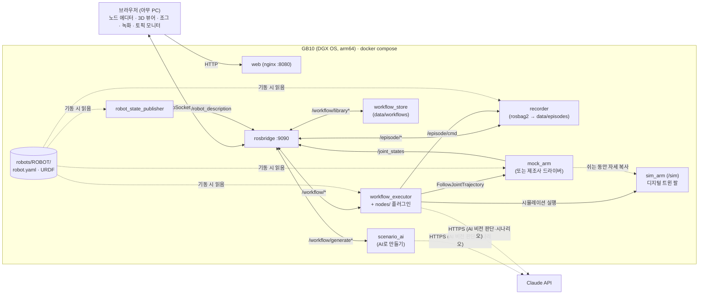

# physical-ai

미니 PC(Dell Pro Max GB10)에 올려서 로봇팔을 웹 브라우저로 프로그래밍하고, 모니터링하고, 학습용 데이터를 녹화하는 솔루션.

- **노코드 워크플로**: 비개발자가 노드를 연결해 공정을 만든다. 블록 추가·삭제·설정은 Dify 편집기 방식(노드 아래 +, 연결선 가운데 +, 검색되는 블록 선택 창, 노드 위 툴바, 단계 이름 바꾸기). 조건 분기(예/아니오), 병렬 실행과 합류, 반복 N회. 용도별 색(동작·흐름·장비·데이터), 핵심 항목만 보이고 나머지는 '고급'으로 접힘
- **만들고 → 반영하고 → 시뮬레이션**: GB10에 이름 붙여 저장(누가 접속하든 같은 워크플로), '시뮬레이션'은 디지털 트윈 팔에서만 실행(실제 로봇·장비는 그대로), '실행'은 실제 로봇
- **디지털 트윈**: 트윈 보기에서 3D가 주화면이고 오른쪽 위에 실제 카메라 화면이 나란히 보임. 선택한 단계의 목표 자세를 고스트로 미리 보기, 워크플로 전체 동작 경로(팔 끝이 지나는 길·분기·반복 포함)를 선으로 미리 보기, 실행 중 명령 목표 vs 실제 자세, 실제 로봇/시뮬레이션 표시
- **운영 화면 (현장 작업자)**: 편집 없이 큰 숫자로 작업 상태·현재 단계·반복 진행(k/N)·경과 시간, 가운데 3D, 오른쪽 카메라, 아래 오늘 운영 현황 KPI(실행·완료율·평균 소요·처리 반복·정지·오류, 어제 대비, 실제/시뮬레이션 따로)와 최근 실행. 실행 기록은 GB10 `data/runs.jsonl`에 쌓임 (산업용 팔레타이저 HMI의 Monitoring 화면 구성 참고)
- **AI 인식 (VLM)**: 'AI 비전 판단' 노드가 카메라 영상을 보고 질문(예: "집을 부품이 있나요?")에 예/아니오로 답해 분기. 판단 근거는 '기록' 탭에 남음
- **카메라 실시간 화면**: 오른쪽 '카메라' 탭과 AI 비전 판단 블록 설정에서 어떤 카메라를 보는지, 연결 상태(fps·해상도), 실시간 화면을 확인. 카메라가 없으면 모의 카메라로 시연
- **AI로 만들기**: 작업을 말로 설명하면 AI가 지금 서버에 있는 노드만으로 시나리오(분기·반복·비전 판단 포함)를 만들어 편집기로 불러옴 → 사람이 확인하고 시뮬레이션
- **기본 안전·조작**: 헤더의 **비상정지**(즉시 정지 + 해제 전까지 실행·조그·홈 이동 잠금, 해제는 두 번 눌러야 함), 조그 패널의 **홈으로**(로봇 프로파일의 홈 자세)
- **ROS2 연동**: 아무 토픽이나 실시간으로 보기, 신호 대기·발행 (그리퍼/PLC/센서 연결)
- **에피소드 녹화**: 관절 상태·명령·카메라를 rosbag2(mcap)로 녹화. 작업 설명(지시문)과 성공/실패를 함께 저장 → 모방학습/VLA 데이터
- **모의 로봇팔**: 하드웨어 없이 개발

## 무엇을 바꿀 때 어디를 고치나

| 하고 싶은 일 | 고치는 곳 | 코드 수정 |
|---|---|---|
| 다른 로봇(또는 작업 셀)에 붙이기 | `robots/<이름>/robot.yaml` + URDF 추가, `.env`에 `ROBOT=<이름>` | 없음 |
| 홈 자세 | `robots/<이름>/robot.yaml`의 `home` (°) | 없음 |
| 웹 비상정지를 드라이버/안전 PLC에도 알리기 | `robot.yaml`의 `estop_topic` (std_msgs/Bool) | 받는 쪽 연결 |
| AI 기능 켜기 | GB10의 `.env`에 `ANTHROPIC_API_KEY=...` (저장소에 넣지 않음) | 없음 |
| AI 비전 판단에 쓸 카메라 | `robots/<이름>/robot.yaml`의 `camera_topic` (실제 카메라를 달면 `mock_camera` 줄 삭제) | 없음 |
| 카메라 등 녹화할 토픽 추가 | `robots/<이름>/robot.yaml`의 `record_topics` | 없음 |
| 새 장비/기능을 워크플로 노드로 | `ros/nodes/<파일>.py` 하나 추가 | 웹은 수정 없음 (UI 자동 생성) |
| 업데이트 배포 | `git pull && docker compose up -d --build` | — |

웹은 특정 로봇을 모릅니다. 관절 이름, URDF, 노드 타입, 녹화 상태를 전부 ROS 토픽으로 받습니다.
매 push마다 GitHub Actions가 웹 빌드(+ 되돌리기·복사 붙여넣기 검사)와 ROS 스모크 테스트(실행·정지·오류·녹화·분기·병렬·반복·시뮬레이션·저장소·AI 비전 판단·홈·비상정지)를 돌려서 업데이트가 기존 기능을 깨는지 확인합니다.



## 폴더

| 경로 | 내용 |
|---|---|
| `robots/<이름>/` | 로봇 프로파일: `robot.yaml`(관절, 액션, 모의 여부, 녹화 토픽) + URDF |
| `ros/workflow_executor.py` | 그래프를 걷는 실행기: 출력 포트별 진행, 병렬 갈래, 합류, 실제/시뮬레이션 모드 (노드 타입을 모름) |
| `ros/nodes/` | 노드 타입 플러그인: `motion`(MoveJ), `flow`(대기·조건 분기·반복·합류), `vision`(AI 비전 판단), `topics`(그리퍼, 고급: 신호 대기/토픽 발행), `episode`(녹화 시작/종료) |
| `ros/ai_client.py` | Claude 호출 한 곳 (모델·오류 메시지). 비전 판단과 시나리오 생성이 같이 씀 |
| `ros/scenario.py`, `ros/scenario_ai.py` | AI 시나리오 생성: 노드 목록 → 프롬프트, 결과 검사·보정(`validate`) / ROS 노드 |
| `ros/workflow_store.py` | 워크플로 저장소 (GB10 `data/workflows/`) |
| `ros/recorder.py` | 에피소드 녹화기 (rosbag2) |
| `ros/mock_camera.py` | 모의 카메라: 작업대에 부품이 놓였다 치워지는 장면을 `camera_topic`으로 (JPEG 또는 rgb8) |
| `ros/mock_arm.py` | 모의 팔 (`/joint_states` + `FollowJointTrajectory`). `/sim`에 하나 더 띄워 디지털 트윈 팔로 씀 |
| `ros/bringup.launch.py` | 프로파일을 읽어 필요한 노드만 기동 |
| `ros/smoke_test.py`, `ros/test_ai.py` | 통합 테스트 / AI 부분 단위 테스트 (API 키 없이, CI에서도 실행) |
| `web/` | React + React Flow + three.js/urdf-loader + roslib |
| `data/episodes/`, `data/workflows/` | 녹화 결과, 저장된 워크플로 (git 제외) |
| `TASKS.md` | 진행 체크리스트 / 로드맵 |

## 실행

### GB10 (운영)
```bash
git clone https://github.com/sgustjd2/physical-ai.git && cd physical-ai
docker compose up -d --build
```
브라우저에서 `http://<GB10 IP>:8080`. `ros/`, `robots/`는 마운트되어 있어서 수정 후 `docker compose restart ros`만 하면 됩니다.

동작 확인:
```bash
docker compose exec ros bash -c "source /opt/ros/jazzy/setup.bash && cd /ros && python3 smoke_test.py"
```

### 개발 PC
```bash
cd web && npm install && npm run dev
```
`http://localhost:5173/?ros=ws://<GB10 IP>:9090` 처럼 `?ros=`로 다른 머신의 rosbridge에 붙을 수 있습니다.
Windows/Mac의 Docker Desktop은 `network_mode: host`가 다르게 동작하므로, ROS 컨테이너만 직접 띄울 땐:
```bash
docker build -t physical-ai-ros ros && docker run --rm -p 9090:9090 -v ./ros:/ros -v ./robots:/robots -v ./data:/data physical-ai-ros
```
Docker 없이 WSL(Ubuntu 24.04)에서 [pixi](https://pixi.sh) + RoboStack(`robostack-jazzy` 채널)으로 sudo 없이 ROS2를 띄울 수도 있습니다.
WSL 미러 네트워킹에서는 DDS 디스커버리가 막히므로 `export FASTDDS_BUILTIN_TRANSPORTS=SHM`(같은 머신 안 통신만)을 켜야 합니다.

## 새 로봇 붙이기

1. `robots/demo_arm/`을 복사해 `robots/<이름>/`을 만들고 `robot.yaml`을 고칩니다.
   ```yaml
   joints: [shoulder_pan_joint, shoulder_lift_joint, elbow_joint, wrist_1_joint, wrist_2_joint, wrist_3_joint]
   trajectory_action: /scaled_joint_trajectory_controller/follow_joint_trajectory
   mock: false                 # 제조사 드라이버를 따로 띄움
   # urdf: 생략 → 드라이버가 /robot_description 을 발행
   record_topics: [/joint_states, /workflow/command, /workflow/status, /tf, /tf_static, /camera/color/image_raw/compressed]
   ```
2. 제조사 ROS2 드라이버를 같은 네트워크·`ROS_DOMAIN_ID`로 띄웁니다 (보통 제조사 제공 Docker 이미지, `network_mode: host`).
   ros2_control `joint_trajectory_controller`를 쓰는 드라이버면 `/joint_states` + `FollowJointTrajectory`를 그대로 제공합니다.
3. `.env`에 `ROBOT=<이름>` 넣고 `docker compose up -d`.

4. **메시가 있는 제조사 URDF**: description 패키지(예: `ur_description`)를 `robots/<이름>/` 안에 그대로 복사하면 `package://ur_description/…` 메시를 웹이 `/robots/<이름>/ur_description/…`에서 받습니다 (STL·DAE·GLB). 폴더 이름이 다르면 `robot.yaml`의 `mesh_packages`에 `패키지: 폴더`로 적습니다.
5. **작업 셀**: `robot.yaml`의 `scene`에 작업대·지그·상자 등을 적으면 3D 뷰와 디지털 트윈에 로봇과 함께 그려집니다 (상자·원기둥·구 또는 STL/GLB 파일, 위치는 로봇 기준 m·라디안). 데모 프로파일에 예시가 있습니다.
6. **팔 끝(TCP)**: 3D 경로 미리보기는 `robot.yaml`의 `tcp_link`(그리퍼·툴 끝 링크)가 지나는 길을 그립니다. 없으면 URDF 맨 끝 링크(보통 플랜지)를 쓰고, 이름이 틀리면 3D 화면에 경고가 뜹니다. 툴 끝 링크가 URDF에 없으면 고정 조인트로 추가합니다 (데모 `tool_tip` 참고).

> 웹(nginx)은 `robots/` 폴더를 읽기 전용으로 `/robots/`에 마운트해 메시·작업 셀 파일을 줍니다 (개발 서버도 같은 경로).

## 새 노드 타입 추가

`ros/nodes/`에 파일 하나를 추가하고 `docker compose restart ros` 하면 웹 팔레트에 나타납니다.

```python
# ros/nodes/inspection.py
from std_msgs.msg import String
from nodes import field, node

GROUP = '검사'   # 팔레트 분류 (같은 분류 = 같은 색)
ICON = 'vision'  # 분류 아이콘: arm | flow | device | data | vision
ORDER = 3        # 팔레트에서 분류 순서

@node('inspect', '외관 검사', desc='카메라로 외관을 검사해 합격/불량으로 나눕니다',   # desc → 블록 선택 창 설명
      resource='camera_station',   # 쓰는 장비: 같은 장비를 동시에 쓰는 병렬 갈래는 웹이 실행 전에 막음
      fields=[field('model', '검사 모델', 'select', 'A형', options=['A형', 'B형']),
              field('timeout', '결과 대기 (s)', 'number', 3, advanced=True)],   # advanced → '고급 설정'에 접힘
      outputs=[('ok', '합격'), ('ng', '불량')])                                # 출력 포트 = 분기
def inspect(ctx, d):
    if ctx.sim:                       # 시뮬레이션 실행: 실제 장비를 쓰지 않는다
        return 'ok'
    m = ctx.wait_for('/vision/result', String, lambda m: True, float(d.get('timeout') or 3))
    return 'ok' if m.data == 'OK' else 'ng'
```
노드 함수가 돌려준 포트에 연결된 단계로 진행하고, 한 포트에 여러 단계를 연결하면 병렬로 실행됩니다.
`advanced=True`를 노드에 주면 팔레트의 '고급' 영역에 들어갑니다 (ROS 토픽을 직접 다루는 노드 등).
`ctx`가 제공하는 헬퍼(`sleep`, `wait_until`, `wait_for`, `publish`, `on_finish`, `param`)와 필드 종류는 [`ros/nodes/__init__.py`](ros/nodes/__init__.py)에 정리되어 있습니다.
기다릴 때는 반드시 `ctx` 헬퍼를 써야 정지 버튼이 먹습니다.

## 에피소드 녹화

- **수동** (조그/텔레옵 시연): 오른쪽 "에피소드 녹화" 패널에 작업 설명 → 녹화 → 성공/실패로 종료
- **워크플로 안에서**: `에피소드 시작 → 작업 노드들 → 에피소드 종료`. 루프 안에 두면 한 바퀴 = 한 에피소드.
  종료 노드 없이 끝나거나 정지/오류가 나면 그 상태(`done`/`stopped`/`error`)로 자동 종료됩니다.

```
data/episodes/20261010-141316-372_빨간_블록_집기/
  bag/            rosbag2 (mcap): 관절 상태, 이동 명령(/workflow/command), TF, 카메라 …
  episode.json    task(지시문), result, robot, topics, started/ended/duration, workflow, vision(녹화 중 AI 비전 판단 라벨)
  record.log
```
확인: `ros2 bag info data/episodes/<이름>/bag` 또는 [Foxglove](https://foxglove.dev)로 mcap 열기.
데모 프로파일은 카메라(모의 카메라)도 녹화하고, 녹화 중 AI 비전 판단이 있으면 질문·답·확신·근거·녹화 시작부터의 시각(t)을 `episode.json`의 `vision`에 남깁니다 (LeRobot 변환 시 `conversion.json`의 에피소드 항목에도 복사).
녹화기는 대상 토픽 구독이 실제로 시작된 뒤에 "녹화 중"으로 응답하므로 시작 직후 동작도 빠지지 않습니다.
**녹화 다시 보기·정리** (녹화 탭에서 에피소드를 누름): 3D와 카메라로 다시 보기(녹화를 `/replay/<토픽>`으로 재생하므로 실제 로봇·트윈은 움직이지 않음), 녹화 중 AI 판단 확인, 성공/실패 고치기(학습 변환은 성공만 씀), 지우기(`data/episodes/.trash`로 옮기고 되돌리기 가능, 앱은 영구 삭제하지 않음 — 휴지통은 필요할 때 직접 비움).
전원 차단 등으로 마무리 못 한 에피소드는 다음 기동 때 `result: interrupted`로 표시됩니다 (`ros2 bag reindex`로 bag 복구 가능).

## LeRobot 데이터셋 변환

녹화한 에피소드를 [LeRobot](https://github.com/huggingface/lerobot) Dataset v3로 바꿉니다 (SmolVLA·ACT 등 학습 입력).

```bash
docker compose run --rm ai python convert_lerobot.py /data/episodes --out /data/lerobot/pick_v1
```

- 기본은 `result: success`인 에피소드만 쓰고, 작업 설명(지시문)이 없는 에피소드는 건너뜁니다 (`--result success fail`로 바꿀 수 있음).
- 로봇별 매핑은 `robots/<이름>/robot.yaml`의 `dataset` 섹션에 둡니다: 관절(그리퍼 포함 가능), 카메라 이름 ↔ 토픽, action 정의.
  - `action: next_state`: 다음 프레임의 관절값 (리더 팔 없이 조그·워크플로로 녹화할 때)
  - `action: /leader/joint_states`: 리더-팔로워 텔레옵이면 리더 팔 토픽
- 프레임은 `fps` 간격으로 리샘플링합니다 (각 시각 직전의 최신 메시지). 카메라는 `sensor_msgs/Image`(rgb8·bgr8·mono8 등)와 `CompressedImage`를 지원합니다.
- ROS 설치 없이 동작합니다 (mcap 파일에 메시지 정의가 들어 있음). 결과 폴더의 `conversion.json`에 어떤 녹화에서 어떤 설정으로 만들었는지 남습니다.
- 점검: `docker compose run --rm ai python check_dataset.py /data/lerobot/pick_v1` — 학습이 읽는 그대로 열어서 프레임 간격(1/fps)·frame_index, action=다음 프레임 상태(next_state), 관절 값이 URDF 한계·속도 한계 안인지, 카메라 프레임 디코딩·크기, 지시문을 확인합니다. 문제가 있으면 종료 코드 1 (화면이 거의 단색이거나 내내 멈춰 있으면 '주의'로만 표시). CI도 변환 직후 이 점검을 돌립니다. 통과하면 에피소드마다 재생용 궤적(`replay/episode_NNN.json`, 학습 데이터의 action 그대로)을 남기고, 워크플로의 **녹화 동작 재생** 블록이 이것을 시뮬레이션(트윈)으로 재생해 눈으로 확인하거나 실제 팔로 시연을 반복할 수 있습니다.
- 확인: `LeRobotDataset('local/pick_v1', root='data/lerobot/pick_v1')`

## 워크플로 노드 (기본 제공)

| 분류 | 노드 | 하는 일 | 시뮬레이션 실행에서 |
|---|---|---|---|
| | 시작 | 실행 시작점 | |
| 동작 | MoveJ 관절 이동 | 관절 각도(°)로 이동. "현재 자세 저장"으로 조그한 자세를 티칭 | 트윈 팔만 움직임 |
| 동작 | 홈 위치로 이동 | 로봇 프로파일의 `home` 자세로 (티칭 없이) | 트윈 팔만 움직임 |
| 동작 | 녹화 동작 재생 | 학습 데이터셋으로 변환한 시연을 그대로 다시 움직임 (데이터셋·에피소드는 드롭다운: 실행기가 `data/lerobot/*/replay`를 5초마다 훑어 알려 줌). 첫 자세까지는 0.5 rad/s 이하로 천천히 | 트윈에서 재생 (데이터 눈으로 확인) |
| 흐름 | 대기 | N초 대기 | 그대로 |
| 흐름 | 조건 분기 | 신호(토픽) 값을 보고 **예/아니오**로 갈라짐 | 지정한 방향(고급 설정)으로 |
| 흐름 | 반복 | **반복** 쪽으로 N번 보낸 뒤 **완료** 쪽으로 | 그대로 |
| 흐름 | 합류 | 병렬 갈래가 모두 도착하면 한 번 진행 | 그대로 |
| AI 인식 | AI 비전 판단 | 카메라 영상을 보고 질문에 **예/아니오**. 확신이 낮으면 정지(또는 아니오로 처리, 고급 설정) | AI를 부르지 않고 지정한 답(고급 설정)으로 |
| 장비 연동 | 그리퍼 | 열기/닫기 (프로파일의 `gripper_topic`) | 보내지 않음 |
| 장비 연동 (고급) | 신호 대기, 토픽 발행 | ROS 토픽을 직접 다룸 | 통과 / 보내지 않음 |
| 데이터 수집 | 에피소드 시작 / 종료 | 녹화 구간 지정 + 작업 설명, 결과(success/fail) | 녹화하지 않음 |

한 출력에 여러 단계를 연결하면 동시에 실행되고(병렬), 앞 단계로 되돌아가는 연결은 반복입니다(반복 노드의 횟수 또는 정지 버튼까지).
연결은 점을 끌어도 되고, 노드를 선택해 설정 패널의 '다음 단계'에서 골라도 됩니다(키보드·터치).

## AI: 비전 판단과 시나리오 만들기

GB10의 `.env`에 API 키를 넣고 `docker compose up -d` 하면 켜집니다 (키는 저장소에 넣지 않습니다).
```bash
echo "ANTHROPIC_API_KEY=sk-ant-..." >> .env
```
- **AI 비전 판단** 노드: `camera_topic`(또는 블록 설정의 '카메라' 선택)에서 최신 한 장을 받아 질문과 함께 Claude(`claude-opus-5-5`)에 보냅니다. 답은 `예/아니오 + 확신(높음·보통·낮음) + 근거`이고, 근거는 '기록' 탭에 남습니다. 확신이 낮으면 기본은 정지(현장에서 사람이 확인), 고급 설정에서 '아니오로 처리'로 바꿀 수 있습니다. 판단 한 번에 수 초가 걸리므로 고속 라인 검사가 아니라 "작업 전에 상황 확인" 용도입니다.
- **AI로 만들기** (문서 바): 작업을 말로 설명하면 지금 실행기에 있는 노드 타입만으로 워크플로를 만듭니다. 없는 장비는 만들어 내지 않고, 모르는 자세는 0으로 두고 경고로 알려 줍니다. 결과는 바로 실행하지 않고 편집기로 불러와 사람이 자세를 티칭하고 시뮬레이션으로 검증한 뒤 실행합니다.
- 키가 없거나 인터넷이 막혀 있으면 노드는 이유를 보여 주며 오류로 멈추고, 나머지 기능은 그대로 동작합니다. 인터넷이 없는 공장이면 로컬 VLM(vLLM 등)으로 `ros/ai_client.py` 한 곳만 바꾸면 됩니다 (`TASKS.md`).

## 카메라

- **어떤 카메라를 쓰나**: 로봇 프로파일의 `camera_topic`이 기본 카메라입니다. AI 비전 판단 블록의 '카메라'에서 블록마다 다른 카메라(ROS 네트워크의 이미지 토픽)를 고를 수 있습니다.
- **연결됐나**: 블록 설정과 오른쪽 '카메라' 탭에 상태가 보입니다: 연결됨(fps·해상도·압축 여부) / 신호 없음(3초 넘게 프레임 없음) / 토픽 없음(드라이버가 안 떠 있음).
- **실시간 화면**: `sensor_msgs/CompressedImage`(JPEG·PNG)는 10fps, 원본 `sensor_msgs/Image`(rgb8·bgr8·mono8 등)는 무거워서 2fps로 받습니다. 대부분의 카메라 드라이버(RealSense, usb_cam 등)는 `.../compressed` 토픽을 함께 내므로 그쪽을 `camera_topic`으로 쓰는 것을 권장합니다. 화면은 보이는 동안에만 받고, 같은 카메라를 여러 화면(카메라 탭·트윈 보기·블록 미리보기)이 보면 한 번 받아 한 번 디코딩한 프레임을 나눠 그립니다.
- **보기용 카메라 선택**: 오른쪽 '카메라' 탭과 트윈 보기의 카메라는 같은 선택을 씁니다(브라우저에 기억). 블록이 쓰는 카메라 설정은 바뀌지 않습니다.
- **카메라가 없을 때**: 프로파일에 `mock_camera: true`면 모의 카메라가 작업대 장면(부품이 4초마다 놓였다 치워짐)을 보냅니다.

## 만들기 → 반영 → 시뮬레이션 → 실행

1. **만들기**: 노드 아래의 **+**를 누르면 그 다음에, 연결선 가운데의 **+**를 누르면 그 사이에 블록이 들어갑니다(블록 선택 창에서 검색 가능, 왼쪽 위 '블록 추가'는 선택한 노드 뒤 또는 화면 가운데). 선택한 노드 위 툴바로 시험·복제·삭제하고, 오른쪽 설정 패널에서 값을 채우고 단계 이름을 바꿉니다(예: "부품 잡기"). 블록은 **복사·잘라내기·붙여넣기**(Ctrl+C·Ctrl+X·Ctrl+V, 터치는 노드 툴바 복사 + 블록 추가 옆 붙여넣기)로 옮길 수 있고, 선택한 블록 사이의 연결도 함께 복사되어 다른 워크플로·다른 탭에도 붙습니다(잘라낸 블록을 같은 워크플로에 붙이면 원래 자리·원래 연결로 되돌아감. 그새 이어질 블록이 지워졌으면 어떤 연결이 빠졌는지 경고로 알려 줌). 잘못 바꿨으면 **되돌리기/다시 하기**(블록 추가 옆 버튼, Ctrl+Z / Ctrl+Shift+Z·Ctrl+Y): 블록 추가·삭제·연결·이동·값 수정·정렬·열기·AI 불러오기가 모두 한 단계씩 되돌려집니다(드래그·입력은 1초 안의 연속 동작을 한 단계로). '열기 → 예제'에 분기·병렬·반복이 들어간 픽앤플레이스 예제가 있습니다.
2. **반영**: '저장'을 누르면 GB10의 `data/workflows/`에 이름으로 저장되어 다른 PC·태블릿에서도 '열기'로 씁니다. 저장 후 바뀐 내용이 있으면 이름 옆에 '저장 안 됨'이 뜹니다.
2-1. **실행 전 점검**: 편집하는 동안 실행하다 멈출 문제를 미리 표시합니다. 같은 장비(로봇팔·그리퍼)를 동시에 쓰는 병렬 갈래, 비어 있거나 숫자가 아닌 관절 값·숫자 칸, 이 서버에 없는 블록은 빨간 테두리 + 블록 설정에 이유, 시작과 이어지지 않은 블록은 점선(실행 안 됨). 문서 바의 '문제 N건'을 누르면 그 블록으로 이동하고, 문제가 있으면 실행·시뮬레이션을 막고 첫 문제로 데려갑니다.
2-2. **동작 점검 (로봇 한계·작업 셀)**: URDF 관절 범위 밖 목표, 속도 한계를 넘는 이동(최고 속도 = 1.5 × 각도/이동 시간)은 문제로 막고 "이동 시간을 N초 이상으로"를 알려 줍니다. 팔 끝이 작업 셀 물체(작업대·상자 등) 안에 들어가거나 지나가면 주의로 알립니다 (팔 끝 한 점 기준, 링크 몸통 충돌은 MoveIt2 몫; 집는 부품처럼 닿아야 하는 물체는 `robot.yaml` scene에 `obstacle: false`). 실행기도 팔에 보내기 전에 같은 범위·속도 규칙으로 멈추므로 AI가 만든 시나리오나 다른 클라이언트도 한계를 넘지 못합니다.
3. **시뮬레이션**: 디지털 트윈 팔(`/sim`)에서만 실행합니다. 실제 로봇·그리퍼·센서는 건드리지 않고, 3D에서는 트윈 팔이 움직이고 실제 로봇 위치가 반투명으로 겹쳐 보입니다. 노드 하나만 시험하려면 인스펙터의 '이 단계만 시뮬레이션'.
4. **실행**: 실제 로봇으로 실행합니다. 헤더에 '실제 로봇' 표시가 뜨는지 확인하세요.

워크플로는 브라우저에도 자동 저장되며, '열기' 메뉴에서 JSON 파일로 내보내기/불러오기도 됩니다.

### 정지와 비상정지

| 버튼 | 하는 일 |
|---|---|
| **정지** (Esc) | 지금 실행을 멈춤 (진행 중인 이동 목표 취소). 바로 다시 실행 가능 |
| **비상정지** | 즉시 멈추고 **잠금**: 해제할 때까지 실행·시뮬레이션·조그·홈 이동을 실행기가 거부. 해제는 빨간 띠의 '해제'를 두 번 눌러야 함. `estop_topic`이 있으면 드라이버/안전 PLC에도 `true`/`false`를 보냄 |

좁은 화면(태블릿 세로·폰)에서는 비상정지 버튼이 오른쪽 아래에 떠 있어 스크롤해도 항상 보입니다.
잠금은 실행기 메모리에 있으므로 ROS 스택을 다시 띄우면 풀린 상태로 시작합니다.

> ⚠️ 웹의 정지·비상정지는 소프트웨어 정지입니다. 네트워크가 끊기면 누를 수 없고, 안전 인증된 정지 회로가 아닙니다. 실제 팔은 반드시 **하드웨어 비상정지**(티치 펜던트·벽면 스위치, 안전 회로)와 안전 펜스/협동 모드 설정을 갖추고 사용하세요.

## 왜 이 구성인가

- **ROS2 Jazzy**: DGX OS가 Ubuntu 24.04 기반이고, Jazzy의 기본 플랫폼이 24.04이며 arm64 바이너리를 제공함
- **표준 인터페이스**: `/joint_states` + `FollowJointTrajectory` + `/robot_description`은 대부분 제조사 ROS2 드라이버의 공통분모라서 팔이 바뀌어도 실행기·웹은 그대로
- **rosbag2(mcap)**: ROS 표준 녹화 포맷이라 Foxglove·`ros2 bag`·LeRobot 변환 도구를 그대로 씀
- **웹(three.js) 3D**: 현장 PC/태블릿 어디서나 접속 가능. Blender 연동은 고품질 씬/오프라인 시뮬레이션용으로 Phase 3에 둠
