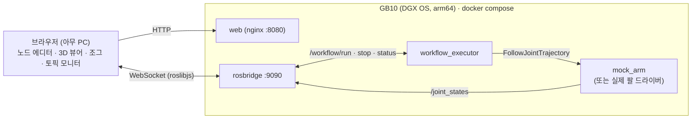

# physical-ai

미니 PC(Dell Pro Max GB10)에 올려서 로봇팔을 웹 브라우저로 프로그래밍하고 모니터링하는 솔루션.

- **노드형 워크플로 에디터**: 노드를 연결해 작업 순서를 만들고 실행. 실행 중인 노드가 실시간으로 강조 표시됨
- **3D 뷰어**: URDF 로봇이 `/joint_states`를 따라 실시간으로 움직임
- **ROS2 연동**: 아무 토픽이나 실시간으로 보기, 토픽 조건 대기, 토픽 발행 (그리퍼/PLC/센서 연결)
- **모의 로봇팔**: 하드웨어 없이 개발하고 미리 시뮬레이션. 실제 팔로 바꿀 때 코드 수정 없이 런치 인자만 변경



## 폴더

| 경로 | 내용 |
|---|---|
| `ros/` | ROS2 Jazzy 노드: `workflow_executor.py`(그래프 실행), `mock_arm.py`(모의 팔), `bringup.launch.py`, `smoke_test.py` |
| `web/` | React + React Flow(노드 에디터) + three.js/urdf-loader(3D) + roslib |
| `web/public/robot.urdf` | 개발용 6축 팔 모델. 실제 팔은 제조사 URDF로 교체 |
| `docker-compose.yml` | GB10 배포 (ros + web) |
| `TASKS.md` | 진행 체크리스트 / 로드맵 |

## 실행

### GB10 (운영)
```bash
git clone https://github.com/sgustjd2/physical-ai.git && cd physical-ai
docker compose up -d --build
```
브라우저에서 `http://<GB10 IP>:8080`. ROS 코드(`ros/*.py`)는 마운트되어 있어서 수정 후 `docker compose restart ros`만 하면 됩니다.

동작 확인:
```bash
docker compose exec ros bash -c "source /opt/ros/jazzy/setup.bash && cd /ros && python3 smoke_test.py"
```

### 개발 PC
```bash
cd web && npm install && npm run dev
```
`http://localhost:5173/?ros=ws://<GB10 IP>:9090` 처럼 `?ros=`로 다른 머신의 rosbridge에 붙을 수 있습니다.
Windows/Mac의 Docker Desktop은 `network_mode: host`가 다르게 동작하므로, ROS 컨테이너만 직접 띄울 땐:
```bash
docker build -t physical-ai-ros ros && docker run --rm -p 9090:9090 -v ./ros:/ros physical-ai-ros
```
Docker 없이 WSL(Ubuntu 24.04)에서 [pixi](https://pixi.sh) + RoboStack(`robostack-jazzy` 채널)으로 sudo 없이 ROS2를 띄울 수도 있습니다.
WSL 미러 네트워킹에서는 DDS 디스커버리가 막히므로 `export FASTDDS_BUILTIN_TRANSPORTS=SHM`(같은 머신 안 통신만)을 켜야 합니다.

## 실제 로봇팔 연결

제조사 ROS2 드라이버(ros2_control `joint_trajectory_controller`)가 `/joint_states`와 `FollowJointTrajectory` 액션을 제공하면 바로 붙습니다. `.env`에:
```
LAUNCH_ARGS=mock:=false trajectory_action:=/joint_trajectory_controller/follow_joint_trajectory joints:=[shoulder_pan_joint,shoulder_lift_joint,elbow_joint,wrist_1_joint,wrist_2_joint,wrist_3_joint]
```
그리고 `web/public/robot.urdf`를 해당 팔 URDF로 교체합니다 (조인트 이름이 `joints`와 같아야 함).

> ⚠️ 웹의 **정지** 버튼은 소프트웨어 정지(진행 중 목표 취소)입니다. 비상정지(E-stop)를 대신하지 않습니다. 실제 팔은 반드시 하드웨어 비상정지와 안전 펜스/협동 모드 설정을 갖추고 사용하세요.

## 워크플로 노드

| 노드 | 하는 일 |
|---|---|
| 시작 | 실행 시작점 |
| MoveJ 관절 이동 | 관절 각도(°)로 이동. "현재 자세 저장"으로 조그한 자세를 티칭 |
| 대기 | N초 대기 |
| 토픽 조건 대기 | 토픽의 필드가 조건을 만족할 때까지 대기 (예: `/sensor/ready` `data == true`) |
| 토픽 발행 | 아무 메시지나 발행 (예: 그리퍼 `std_msgs/msg/Bool` `{"data": true}`) |

노드에서 나가는 엣지는 하나이고, 앞 노드로 되돌아가는 엣지를 그리면 반복합니다(정지 버튼으로 멈춤).
워크플로는 브라우저에 자동 저장되며 JSON으로 내보내기/불러오기 할 수 있습니다.

새 노드 타입 추가 = `web/src/nodes.jsx`의 `SPECS`에 한 항목 + `ros/workflow_executor.py`의 `step()`에 분기 하나.

## 왜 이 구성인가

- **ROS2 Jazzy**: DGX OS가 Ubuntu 24.04 기반이고, Jazzy의 기본 플랫폼이 24.04이며 arm64 바이너리를 제공함
- **웹(three.js) 3D**: Blender 대신 브라우저에서 바로 보이므로 현장 PC/태블릿 어디서나 접속 가능. Blender 연동은 고품질 씬/오프라인 시뮬레이션용으로 Phase 3에 둠 (`TASKS.md`)
- **표준 인터페이스**: `/joint_states` + `FollowJointTrajectory`는 대부분 제조사 ROS2 드라이버의 공통분모라서 팔이 바뀌어도 실행기·웹은 그대로
