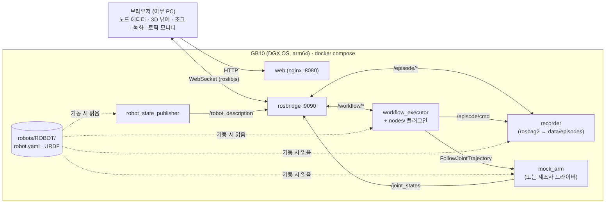

# physical-ai

미니 PC(Dell Pro Max GB10)에 올려서 로봇팔을 웹 브라우저로 프로그래밍하고, 모니터링하고, 학습용 데이터를 녹화하는 솔루션.

- **노드형 워크플로 에디터**: 노드를 연결해 작업 순서를 만들고 실행. 실행 중인 노드가 실시간으로 강조 표시됨
- **3D 뷰어**: 로봇 URDF가 `/joint_states`를 따라 실시간으로 움직임
- **ROS2 연동**: 아무 토픽이나 실시간으로 보기, 토픽 조건 대기, 토픽 발행 (그리퍼/PLC/센서 연결)
- **에피소드 녹화**: 관절 상태·명령·카메라를 rosbag2(mcap)로 녹화. 작업 설명(지시문)과 성공/실패를 함께 저장 → 모방학습/VLA 데이터
- **모의 로봇팔**: 하드웨어 없이 개발하고 미리 시뮬레이션

## 무엇을 바꿀 때 어디를 고치나

| 하고 싶은 일 | 고치는 곳 | 코드 수정 |
|---|---|---|
| 다른 로봇(또는 작업 셀)에 붙이기 | `robots/<이름>/robot.yaml` + URDF 추가, `.env`에 `ROBOT=<이름>` | 없음 |
| 카메라 등 녹화할 토픽 추가 | `robots/<이름>/robot.yaml`의 `record_topics` | 없음 |
| 새 장비/기능을 워크플로 노드로 | `ros/nodes/<파일>.py` 하나 추가 | 웹은 수정 없음 (UI 자동 생성) |
| 업데이트 배포 | `git pull && docker compose up -d --build` | — |

웹은 특정 로봇을 모릅니다. 관절 이름, URDF, 노드 타입, 녹화 상태를 전부 ROS 토픽으로 받습니다.
매 push마다 GitHub Actions가 웹 빌드와 ROS 스모크 테스트(실행·정지·오류·녹화)를 돌려서 업데이트가 기존 기능을 깨는지 확인합니다.



## 폴더

| 경로 | 내용 |
|---|---|
| `robots/<이름>/` | 로봇 프로파일: `robot.yaml`(관절, 액션, 모의 여부, 녹화 토픽) + URDF |
| `ros/workflow_executor.py` | 그래프를 걷는 실행기 (노드 타입을 모름) |
| `ros/nodes/` | 노드 타입 플러그인: `motion`(MoveJ), `flow`(대기), `topics`(토픽 대기/발행), `episode`(녹화 시작/종료) |
| `ros/recorder.py` | 에피소드 녹화기 (rosbag2) |
| `ros/mock_arm.py` | 모의 팔 (`/joint_states` + `FollowJointTrajectory`) |
| `ros/bringup.launch.py` | 프로파일을 읽어 필요한 노드만 기동 |
| `ros/smoke_test.py` | 통합 테스트 (CI에서도 실행) |
| `web/` | React + React Flow + three.js/urdf-loader + roslib |
| `data/episodes/` | 녹화 결과 (git 제외) |
| `TASKS.md` | 진행 체크리스트 / 로드맵 |

## 실행

### GB10 (운영)
```bash
git clone https://github.com/sgustjd2/physical-ai.git && cd physical-ai
docker compose up -d --build
```
브라우저에서 `http://<GB10 IP>:8080`. `ros/`, `robots/`는 마운트되어 있어서 수정 후 `docker compose restart ros`만 하면 됩니다.

동작 확인:
```bash
docker compose exec ros bash -c "source /opt/ros/jazzy/setup.bash && cd /ros && python3 smoke_test.py"
```

### 개발 PC
```bash
cd web && npm install && npm run dev
```
`http://localhost:5173/?ros=ws://<GB10 IP>:9090` 처럼 `?ros=`로 다른 머신의 rosbridge에 붙을 수 있습니다.
Windows/Mac의 Docker Desktop은 `network_mode: host`가 다르게 동작하므로, ROS 컨테이너만 직접 띄울 땐:
```bash
docker build -t physical-ai-ros ros && docker run --rm -p 9090:9090 -v ./ros:/ros -v ./robots:/robots -v ./data:/data physical-ai-ros
```
Docker 없이 WSL(Ubuntu 24.04)에서 [pixi](https://pixi.sh) + RoboStack(`robostack-jazzy` 채널)으로 sudo 없이 ROS2를 띄울 수도 있습니다.
WSL 미러 네트워킹에서는 DDS 디스커버리가 막히므로 `export FASTDDS_BUILTIN_TRANSPORTS=SHM`(같은 머신 안 통신만)을 켜야 합니다.

## 새 로봇 붙이기

1. `robots/demo_arm/`을 복사해 `robots/<이름>/`을 만들고 `robot.yaml`을 고칩니다.
   ```yaml
   joints: [shoulder_pan_joint, shoulder_lift_joint, elbow_joint, wrist_1_joint, wrist_2_joint, wrist_3_joint]
   trajectory_action: /scaled_joint_trajectory_controller/follow_joint_trajectory
   mock: false                 # 제조사 드라이버를 따로 띄움
   # urdf: 생략 → 드라이버가 /robot_description 을 발행
   record_topics: [/joint_states, /workflow/command, /workflow/status, /tf, /tf_static, /camera/color/image_raw/compressed]
   ```
2. 제조사 ROS2 드라이버를 같은 네트워크·`ROS_DOMAIN_ID`로 띄웁니다 (보통 제조사 제공 Docker 이미지, `network_mode: host`).
   ros2_control `joint_trajectory_controller`를 쓰는 드라이버면 `/joint_states` + `FollowJointTrajectory`를 그대로 제공합니다.
3. `.env`에 `ROBOT=<이름>` 넣고 `docker compose up -d`.

> 3D 뷰어는 지금 기본 도형 URDF만 그립니다. `package://` 메시를 쓰는 제조사 URDF는 메시 파일 서빙이 추가로 필요합니다 (`TASKS.md` Phase 2).

## 새 노드 타입 추가

`ros/nodes/`에 파일 하나를 추가하고 `docker compose restart ros` 하면 웹 팔레트에 나타납니다.

```python
# ros/nodes/gripper.py
from std_msgs.msg import Bool
from nodes import field, node

@node('gripper', '그리퍼', fields=[field('close', '동작', 'select', 'true', options=['true', 'false'])])
def gripper(ctx, d):
    ctx.publish('/gripper/cmd', Bool(data=d['close'] == 'true'))
    ctx.sleep(0.5)
```
파일 맨 위에 `GROUP = '그리퍼'`처럼 분류를 적으면 팔레트에서 그 분류로 묶이고 같은 색을 받습니다.
`ctx`가 제공하는 헬퍼(`sleep`, `wait_until`, `wait_for`, `publish`, `on_finish`, `param`)와 필드 종류는 [`ros/nodes/__init__.py`](ros/nodes/__init__.py)에 정리되어 있습니다.
기다릴 때는 반드시 `ctx` 헬퍼를 써야 정지 버튼이 먹습니다.

## 에피소드 녹화

- **수동** (조그/텔레옵 시연): 오른쪽 "에피소드 녹화" 패널에 작업 설명 → 녹화 → 성공/실패로 종료
- **워크플로 안에서**: `에피소드 시작 → 작업 노드들 → 에피소드 종료`. 루프 안에 두면 한 바퀴 = 한 에피소드.
  종료 노드 없이 끝나거나 정지/오류가 나면 그 상태(`done`/`stopped`/`error`)로 자동 종료됩니다.

```
data/episodes/20261010-141316-372_빨간_블록_집기/
  bag/            rosbag2 (mcap): 관절 상태, 이동 명령(/workflow/command), TF, 카메라 …
  episode.json    task(지시문), result, robot, topics, started/ended/duration, workflow
  record.log
```
확인: `ros2 bag info data/episodes/<이름>/bag` 또는 [Foxglove](https://foxglove.dev)로 mcap 열기.
녹화기는 대상 토픽 구독이 실제로 시작된 뒤에 "녹화 중"으로 응답하므로 시작 직후 동작도 빠지지 않습니다.
전원 차단 등으로 마무리 못 한 에피소드는 다음 기동 때 `result: interrupted`로 표시됩니다 (`ros2 bag reindex`로 bag 복구 가능).

## 워크플로 노드 (기본 제공)

| 노드 | 하는 일 |
|---|---|
| 시작 | 실행 시작점 |
| MoveJ 관절 이동 | 관절 각도(°)로 이동. "현재 자세 저장"으로 조그한 자세를 티칭 |
| 대기 | N초 대기 |
| 토픽 조건 대기 | 토픽의 필드가 조건을 만족할 때까지 대기 (예: `/sensor/ready` `data == true`) |
| 토픽 발행 | 아무 메시지나 발행 (예: 그리퍼 `std_msgs/msg/Bool` `{"data": true}`) |
| 에피소드 시작 / 종료 | 녹화 구간 지정 + 작업 설명, 결과(success/fail) |

노드에서 나가는 엣지는 하나이고, 앞 노드로 되돌아가는 엣지를 그리면 반복합니다(정지 버튼으로 멈춤).
워크플로는 브라우저에 자동 저장되며 JSON으로 내보내기/불러오기 할 수 있습니다.

> ⚠️ 웹의 **정지** 버튼은 소프트웨어 정지(진행 중 목표 취소)입니다. 비상정지(E-stop)를 대신하지 않습니다. 실제 팔은 반드시 하드웨어 비상정지와 안전 펜스/협동 모드 설정을 갖추고 사용하세요.

## 왜 이 구성인가

- **ROS2 Jazzy**: DGX OS가 Ubuntu 24.04 기반이고, Jazzy의 기본 플랫폼이 24.04이며 arm64 바이너리를 제공함
- **표준 인터페이스**: `/joint_states` + `FollowJointTrajectory` + `/robot_description`은 대부분 제조사 ROS2 드라이버의 공통분모라서 팔이 바뀌어도 실행기·웹은 그대로
- **rosbag2(mcap)**: ROS 표준 녹화 포맷이라 Foxglove·`ros2 bag`·LeRobot 변환 도구를 그대로 씀
- **웹(three.js) 3D**: 현장 PC/태블릿 어디서나 접속 가능. Blender 연동은 고품질 씬/오프라인 시뮬레이션용으로 Phase 3에 둠
